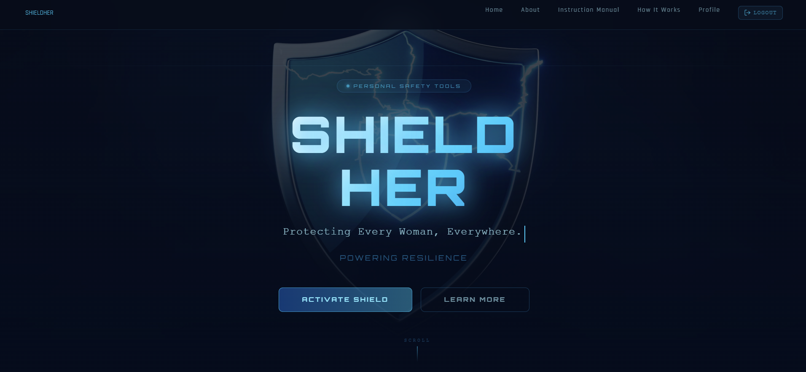
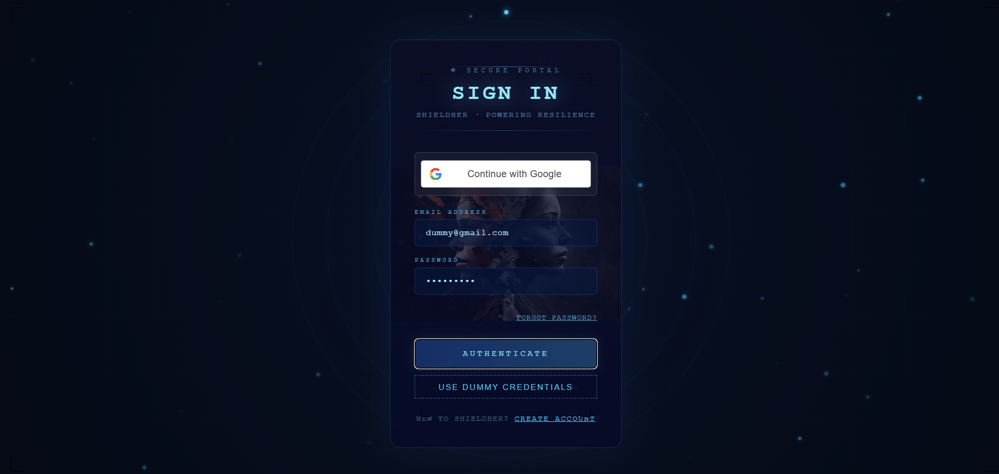
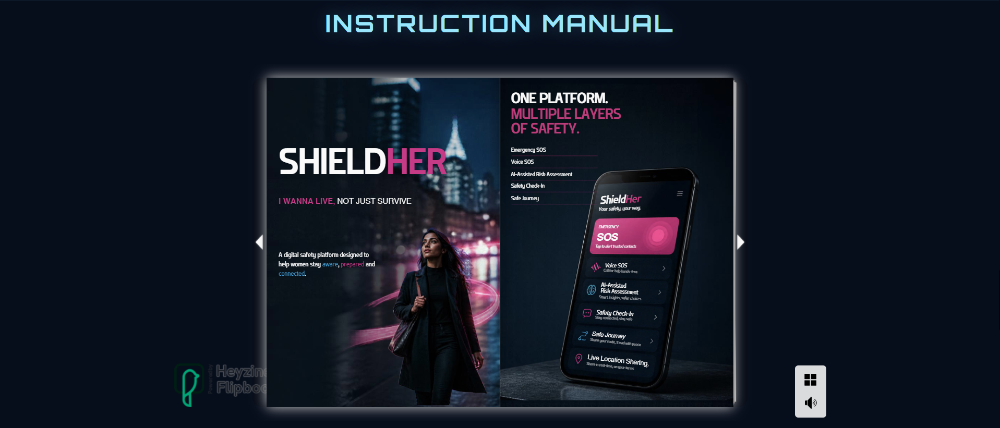
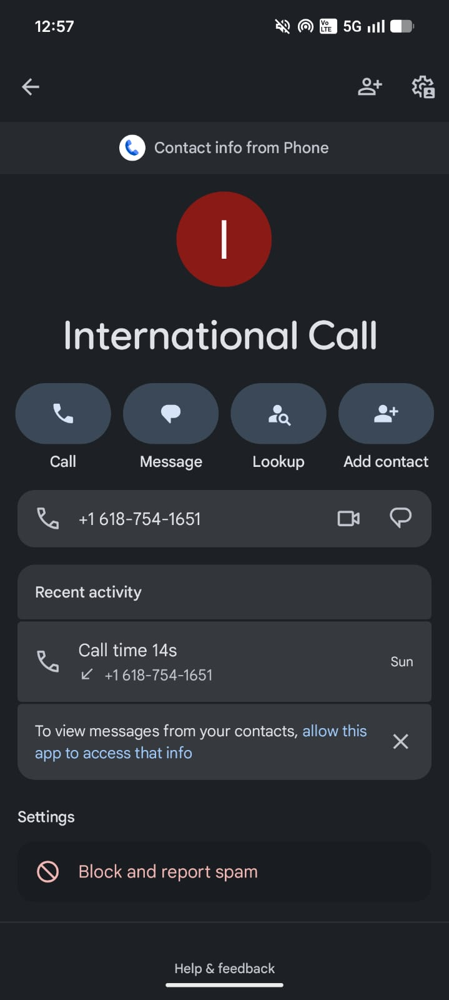
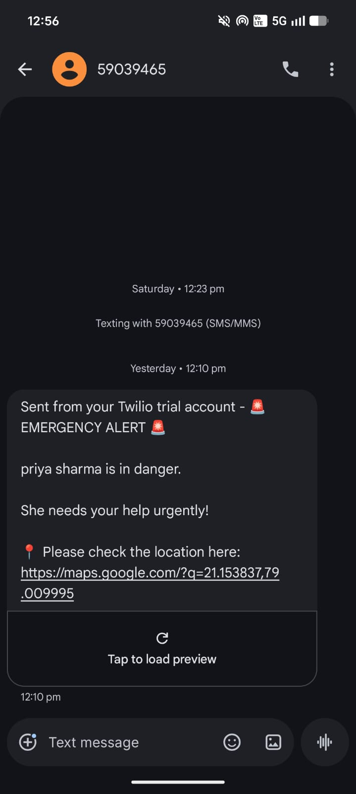

# ShieldHer

ShieldHer is a browser-based safety web application. It brings user-initiated
SOS, optional location sharing, a local risk-assessment model, and personal
safety planning tools together in one interface.

**Hosted app:** [shield-her-her-hack.vercel.app](https://shield-her-her-hack.vercel.app)

## Website Preview

### Home Page



### Login



### Safety / Instructions



### SOS Demonstration

| Phone call activity | Emergency alert text message |
| --- | --- |
|  |  |

## Features

### SOS and location sharing

- Start an SOS manually, or explicitly enable browser speech recognition and
  say **HELP** while the page is open and listening. Voice recognition depends
  on browser support; it does not run in the background or work with a locked
  phone.
- The browser requests a one-time location for the initial SOS. Location
  requires browser permission.
- The authenticated backend attempts SMS and call notifications to saved
  emergency contacts through Twilio. The confirmation page reports contacts
  with at least one successful notification method; it does not confirm
  delivery by each channel.
- Live location sharing is separate and opt-in. The user must start it from
  the SOS confirmation page and can stop it there. Updates require at least
  60 seconds and 50 metres of movement. The active sharing session is held in
  backend memory, expires after two hours, and is single-instance state; live
  coordinates are not stored as location history.
- SOS is never triggered automatically by the risk assessment or the other
  safety tools.

### Safety Center

- **Safety Risk Assessment:** On-demand assessment using time of day, whether
  the user is travelling alone, situation, and selected safety indicators.
  The local primary model is a four-class multinomial logistic-regression
  classifier trained offline on 1,536 synthetic scenarios. A deterministic
  rules-based engine is used if the model cannot be loaded or inference fails.
  The model is a hackathon prototype, not validated predictive intelligence.
  Assessment results are not stored by the backend; the browser can keep a
  limited local history of assessment time, score, and level.
- **Safety Check-In and Safe Journey:** User-configured local reminders and
  check-in state, stored in the browser.
- **Safety Insights:** Summaries based on locally available assessment
  history; insights are limited when there is not enough history.
- **Safety Plan:** Review browser capabilities and save safety preferences
  locally.
- **Safe Places:** The interface is present, but nearby-place search is not
  configured with a places provider.

Local browser data is not synchronized to the backend. Clearing this site's
browser storage removes locally saved safety activity, reminders, journey
state, and preferences.

## Technology

- **Frontend:** React 18, React Router, Vite
- **Backend:** Node.js, Express, MongoDB/Mongoose
- **Authentication:** JWT, email/password, and Google sign-in
- **Notifications:** Twilio
- **Risk model training:** Python and pinned scikit-learn
- **Risk model inference:** Lightweight JavaScript in the backend; Python and
  scikit-learn are not needed to run the backend

## Application structure

```text
frontend/
  src/
    components/       Safety Center and risk-assessment UI
    pages/            Home, profile, SOS, and dashboard pages
    services/         API clients and browser-local safety data
backend/
  controller/         HTTP request handlers
  middleware/         JWT authentication
  models/             MongoDB schemas
  routes/             Auth, profile, SOS, and risk-assessment routes
  services/            Risk inference and deterministic fallback
  ml/                 Synthetic data, training script, and model artifact
  test/                Node built-in test-runner tests
images/                Project image assets
```

## API overview

All API routes are mounted under `/api`:

| Route | Purpose |
| --- | --- |
| `/auth/register`, `/auth/login`, `/auth/google` | Account registration and sign-in |
| `/profile` | Authenticated profile and emergency-contact management |
| `/sos` | Authenticated initial SOS notification |
| `/sos/live/start`, `/sos/live/update`, `/sos/live/stop` | Opt-in live SOS-sharing session |
| `/risk-assessment` | Authenticated risk assessment |

The backend defaults to port `8000` (or `PORT` when set). Authenticated routes
require a bearer token. Live-sharing session state is process-local, so a
multi-instance deployment needs shared ephemeral session storage for updates
to work reliably across instances.

## Local development

### Requirements

- Node.js and npm
- MongoDB connection string
- Twilio credentials and a Twilio sender number to send real SOS notifications

Create `backend/.env` with:

```env
PORT=8000
MONGO_URI=your_mongodb_connection_string
JWT_SECRET=replace_with_a_long_random_secret
TWILIO_ACCOUNT_SID=your_twilio_account_sid
TWILIO_AUTH_TOKEN=your_twilio_auth_token
TWILIO_NUMBER=your_twilio_sender_number
```

Do not commit `.env` files or real credentials. The frontend's shared API
configuration uses `VITE_API_URL` as the backend origin; create
`frontend/.env.local` as needed for your environment:

```env
VITE_API_URL=http://localhost:8000
```

Start the backend and frontend in separate terminals:

```powershell
cd backend
npm install
npm run dev
```

```powershell
cd frontend
npm install
npm run dev
```

Vite serves the frontend on port `5173` by default. Some existing frontend
requests have their own endpoint configuration; ensure they target the backend
you intend to use when changing environments.

## Tests and builds

Run backend tests:

```powershell
cd backend
npm test
```

Run the frontend production build and linter:

```powershell
cd frontend
npm run build
npm run lint
```

The focused local safety-data tests use Node's built-in test runner:

```powershell
cd frontend
node --test test/safetyLocalData.test.js
```

## Re-training the local risk model

The checked-in model is ready for backend inference. To regenerate the
synthetic dataset and fit the model, use Python 3.11 or newer:

```powershell
python -m venv .venv
.venv\Scripts\Activate.ps1
python -m pip install -r backend\ml\requirements.txt
python backend\ml\train_risk_model.py
```

The training data is synthetic and derives its labels from a transparent
prototype rubric. It is not real-world incident data and does not establish
causation, safety, or predictive accuracy. User assessments and coordinates
must not be added to the training data. Coordinates are not model features and
are not sent to an external inference provider.
