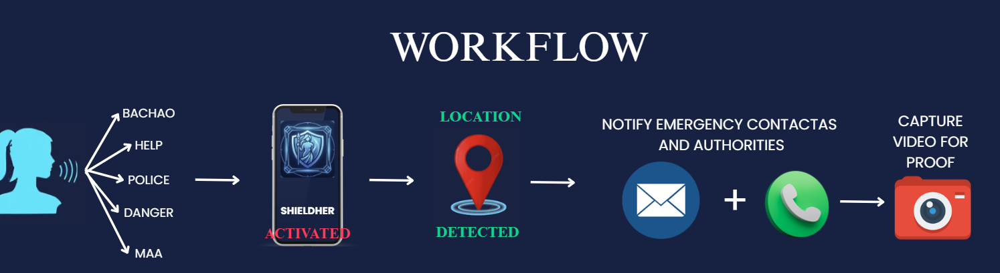

# ShieldHer 

## Overview

**ShieldHer** is a browser-based safety application that helps users alert their emergency contacts and share their location during dangerous situations.

When a user starts an SOS:

* Sends an initial emergency notification to saved contacts
* Captures a one-time location when browser location permission is available
* Supports optional live location sharing when the user explicitly starts it

This project combines **full-stack development and local risk assessment** to build a safety application.

---

## Key Features

* 🎙️ Voice-triggered emergency activation
* 📍 Browser-based location capture and opt-in live location sharing
* 📞 Emergency contact notifications through the backend
* 💬 Initial SOS notification with a location link when location is available
* 🛡️ Safety Risk Assessment

---

## Tech Stack

### Frontend
* React.js
* HTML, CSS, JavaScript

### Backend
* Node.js
* Express.js
* MongoDB (Database)

### Browser capabilities
* Browser geolocation, with user permission
* Browser speech recognition, where supported

### Communication
* Twilio API is integrated in the backend
* Backend uses the configured Twilio service for emergency contact notifications

---

## System Architecture

1. User explicitly starts SOS in the browser or enables voice listening and says HELP
2. The browser requests a one-time location when permission is available
3. The authenticated backend sends the initial notification to emergency contacts
4. The user can explicitly start optional live location sharing from the confirmation page

---

## 🔄 Workflow

<p align="center">
  
</p>

---

## 📸 Output


Live link 🖇️ - https://shield-her-x2gl.vercel.app

<p align="center">
  
  
</p>

---

---

## Project Structure

```
ShieldHer/
│
├── frontend/ (React App)
├── backend/ (Node + Express API)
├── models/ (MongoDB Schemas)
├── routes/ (API Routes)
├── controllers/
└── README.md
```

---

## Installation & Setup

### Frontend

```
cd frontend
npm install
npm start
```

### Backend

```
cd backend
npm install
npm run dev
```

### Environment Variables (.env)

Create a `.env` file in your backend and add the following:

```
MONGO_URI=your_mongodb_connection_string
PORT=5000

# Twilio Credentials (for SMS & Calls)
TWILIO_ACCOUNT_SID=your_twilio_account_sid
TWILIO_AUTH_TOKEN=your_twilio_auth_token
TWILIO_PHONE_NUMBER=your_twilio_phone_number
```

```

## Future Improvements

- AI-based threat detection using audio analysis
- Mobile app integration
- Cloud-based real-time tracking dashboard

---

## Team / Project

Developed as part of an ELITE_HACKATHON project focused on **browser-based safety tools and full-stack web technologies**.

---

⭐ If you like this project, consider giving it a star!

```
